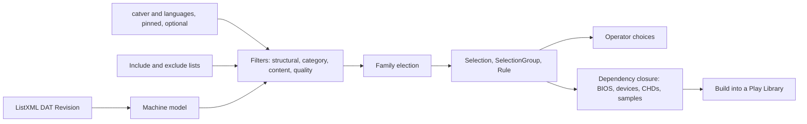

# MAME: what replaces Retool for Selection

Findings for #105, part of #3. Researched 2026-11-12 against sources pinned to a tag or commit: this repo at
`e6414f61`, MAME `mame0289` (ListXML asset `mame0289lx.zip`, SHA-256 `d5d8f402…2817` from the release's
`SHA256SUMS`), MAME source at `c2caa896`, the progetto-SNAPS support files through the `AntoPISA/MAME_SupportFiles`
mirror at `bbeff169`, curateur at `0efa6d69`, mame-curator at `55b1af38`, igir at `87daad07`, oxyromon at `569a4c08`
and BestArcade at `bd8c389`. Counts in §4 were computed locally from the verified ListXML and the pinned support
files. No Source Set, Host or Operator data was read. **Inference** marks conclusions that the sources do not state
directly.

This note answers #105's Selection question: how to go from MAME's full machine list to a curated Play Library. It
covers Audit, Build and dependencies only where they constrain Selection.

## Recommendation

**Build a native Rust arcade selector beside the Retool port, chosen by DAT root.** No existing tool can stand in:
Retool declines MAME and is unmaintained, igir cannot parse MAME descriptions, oxyromon does not elect, and the
curating tools are applications that are GPL-3.0 or unlicensed, except mame-curator (MIT, Python).

- **Input:** the ListXML DAT Revision the Source Set already Follows (ADR 0012). The Selection pins the MAME build,
  as it pins the clone-list commit today.
- **Optional enrichment:** `catver.ini` and `languages.ini`, pinned like `third_party/clone-lists`. They carry no
  licence, so ask their maintainer before baking them into the image; until then, accept them as an Operator drop-in.
  Without them, fall back to a ListXML-only heuristic that agrees with catver about 91% of the time (F1 0.908).
- **Output:** the existing `Selection`, `SelectionGroup` and `Rule` shapes, with MAME stage names, so Operator
  choices, traces and the review UI carry over.
- **Groundwork first:** the engine's DAT reader keeps only `name` and `cloneof`, and ADR 0017 counts only a Game's
  own files, so BIOS and device ROMs read as Missing. Both need extending before an arcade Selection can Build.

Why:

- The criteria every arcade tool converges on are cheap to express: drop non-games, drop gambling, mahjong, mature
  and quiz, drop broken drivers, then elect one member per parent/clone family by an ordered rule chain (§5).
- On MAME 0.289 those criteria take 50,368 machines to about 3,222 games, one per family, and 97% of those families
  match the maintainer's own `Working Arcade Clean.ini` (§4).
- Structural ListXML flags alone leave 27,119 candidates; category data is what makes the default usable (§4).
- It honours #3: *"Do not apply Retool's No-Intro/Redump model as an invented arcade 1G1R policy."* Every rule is an
  explicit, reviewable filter or election step.

## 1. What Title Select has today

| Area | State |
|---|---|
| MAME DAT fetching | **Done** (ADR 0012, #96). `crates/store/src/fetch.rs:539-666` finds the latest release through the GitHub Releases API, fetches the `mameNNNNlx.zip` ListXML asset or a `hash/<list>.xml` software list. Hosts are allowlisted, requests are 1 s apart, and each artifact is fetched at most once a day. Opt-in through `[fetch] mame` (`crates/store/src/config.rs:304-322`). There is no hook for support files. |
| ListXML parsing | `crates/engine/src/dat.rs:113-126` recognises the `<mame>` root and versions the DAT by `build`. `start_game` (`dat.rs:235-243`) **reads only `name` and `cloneof`**. `romof`, `isbios`, `isdevice`, `ismechanical`, `runnable`, `<disk>`, `<device_ref>` and `<driver>` fall through `_ => {}`. |
| Selection engine | The Rust port of Retool (ADR 0015) reads Logiqx and ClrMamePro only. There is **no dispatch by DAT kind**; the only routing point is `system_name` (`crates/selection/src/native/mod.rs:30-39`). `titletools.rs`, `settings.rs` and `filters.rs` assume No-Intro naming. |
| Reusable pieces | `crates/selection/src/choices.rs` (Operator picks per group) and `native/userre.rs` are format-agnostic; `native/overrides.rs:12-63` (`/regex`, `\|exact`, substring matching) is generic. |
| Selection Profile | `SystemSettings` (`crates/api/src/selection.rs:95-119`) is Retool-shaped and `deny_unknown_fields`. The store keeps profiles as opaque, versioned JSON (`crates/store/src/profiles.rs:128-133`). |
| Review UI | `crates/ui/src/screens/selection.rs` renders `SelectionGroup`, roles and `Rule`s as plain strings, so a MAME family maps onto it directly. |
| Audit and Build | ADR 0017: a Game counts only its own files; a clone's parent container counts through `cloneof` (`crates/engine/src/lib.rs:338-447`). BIOS sets (`romof`) and device sets (`device_ref`) are not modelled, and Build packs one TorrentZip per Game from its own sources. |
| Pinned third-party data | `third_party/clone-lists/pins.toml` (repository, commit, `archive_sha256`), `tools/clone-lists/fetch` with extraction hardening, a Renovate regex manager (`renovate.json:26-35`) and `.github/workflows/clone-list-pin.yaml`. |

#3 already sets the policy: machines are selected *"explicitly or through reviewed lists/status/category filters, with
a pinned MAME revision and target/core assumptions"*. BestArcade and curated-mame-arcade-romset are named as
Selection precedents, not dependency-closure engines.

## 2. curateur's `curateur-mame`

The `curateur-mame` CLI (`pyproject.toml:54`, about 2,500 lines under `curateur/mame/`) runs five phases: parse,
filter and build metadata, copy ROMs and CHDs, organise media, then write `gamelist.xml`
(`mame_gamelist_generator.py:75-141`).

- **Inputs:** local files only. A `-listxml` dump, `history.xml`, and `bestgames.ini`, `genre.ini`,
  `multiplayer.ini` and optionally `Game or No Game.ini` from the Extras pack. It does not read catver, nplayers,
  languages, series or controls.
- **Filters, in order** (`mame_metadata_builder.py:112-178`):
  1. `is_game()`: not BIOS, not device, runnable (`mame_xml_parser.py:35-67`). `ismechanical` and `romof` are parsed
     but never used.
  2. An optional inclusion list of shortnames.
  3. An optional `minimum_rating`, mapped from bestgames tiers (`ini_parser.py:104-121`).
  4. An optional Game-or-No-Game filter.
- **Clones are not reduced.** Parents and clones both survive; "clone inheritance" (`mame_metadata_builder.py:252-320`)
  only backfills metadata.
- **No dependency closure.** It assumes a non-merged source and copies `{shortname}.zip` as is, with no BIOS or device
  zips. CHD directories are copied for machines with `<disk>` (`mame_rom_copier.py:252-315`).
- It ignores driver status, controls, orientation, categories, samples and version drift between the XML and the
  INIs. No tests cover any MAME module.

**Carry over:** an Operator inclusion list, a rating threshold, disk-space checks before copying. **Avoid:** flat
shortname copies without dependency closure, and relying on structural flags alone (§4).

## 3. Data sources

### Official ListXML

- Published as a release asset, `https://github.com/mamedev/mame/releases/download/mameNNNN/mameNNNNlx.zip`.
  0.289's is 19.7 MB zipped and 327 MB as XML, with 50,368 machines and root
  `<mame build="0.289 (mame0289)" mameconfig="10">`. Each release carries `SHA256SUMS`; there is no signature.
  Releases come about every one to two months.
- Licence: MAME is GPL-2.0+, most files BSD-3; `hash/` software lists are CC0; "MAME" is a trademark.
- The DTD (`src/frontend/mame/infoxml.cpp:166-320`) carries these curation signals:
  - **Machine:** `isbios`, `isdevice`, `ismechanical`, `runnable`, `cloneof`, `romof`, `sampleof`, `sourcefile`.
  - **`<driver>`:** `status` and `emulation` (good, imperfect, preliminary), plus `cocktail`, `savestate`,
    `requiresartwork`, `unofficial`, `incomplete`.
  - **`<feature>`:** type and status of unemulated or imperfect features.
  - **`<display>`:** `type` (raster, vector, lcd, svg) and `rotate`; no display means screenless.
  - **`<input>`:** `players`, `coins`, and each `<control>` `type` (joy, lightgun, trackball, mahjong, hanafuda,
    gambling, keyboard and others).
  - **Dependencies and media:** `<disk>` (CHD), `<device_ref>`, `<sample>`, `<softwarelist>`, `<biosset>`.
- **Missing:** genre, category, maturity, language and structured region. Region and revision exist only as free text
  in `<description>`, such as "(World 910522)", "(US set 1)" or "(Namco rev. B)" (MAME naming docs).
- A runnable machine needs the union of its own ROMs (less those satisfied through `merge=`), its `romof` chain up to
  the BIOS, each `device_ref`'s ROMs recursively, and its CHDs, which may be deltas against a parent. MAME's
  `src/frontend/mame/audit.cpp:34-239` is the reference behaviour.

### Community support files

| File | Source | Currency at 0.289 | Licence | Verdict |
|---|---|---|---|---|
| `catver.ini` (with `genre.ini`, `mature.ini`, `catlist.ini`) | progetto-SNAPS; GitHub mirror `AntoPISA/MAME_SupportFiles` | Current; 50,368 entries, 1:1 with ListXML | None stated ("©") | Best curation signal; pin only after permission |
| `languages.ini`, `series.ini` | Same | Current | None stated | As catver |
| `category.ini` pack (`Working Arcade Clean.ini`, `ArcadeWorkingParents.ini`, `mame_NOBIOS.ini` and others) | Same | Current | None stated | Cross-check only |
| `bestgames.ini` | Same | Lags (0.280) | None stated | Optional ranking |
| `nplayers.ini` | arcadebelgium.be | Lags (0.278) | None stated | Not needed: `<input players>` covers it |
| `controls.dat` | Abandoned | Frozen at 0.141 (2011) | None | Unusable: use `<control>` |
| `history.xml`, `mameinfo.dat` | Third-party sites | Varies | None | Out of scope: enrichment stays in RomM (research 0005) |

catver's format is `name=Top / Sub`, with a `* Mature *` suffix for mature content and a `[VerAdded]` section. Its
non-game top-level categories at 0.289 include:

- **Not arcade games:** System (7,401, covering BIOS and devices), Computer (2,933), Game Console (473), Handheld
  (1,537), Calculator, Telephone, Printer, Watch, Utilities, Misc., Medical Equipment, Musical Instrument, Music
  Player.
- **Gambling and redemption:** Electromechanical (5,296), Slot Machine (16,295), Gambling (renamed from Casino in
  2024, with a few Casino stragglers), Medal Game, Redemption Game, Luna Park, Whac-A-Mole.
- **Other excludable kinds:** Tabletop (Mahjong, Hanafuda, Shanghai), Quiz, Board Game.

### Curated lists

| Source | Licence | Shape | Verdict |
|---|---|---|---|
| `zr00da/curated-mame-arcade-romset` | Unlicense | 776 shortnames, one per line, curated through pull requests, not pinned to a MAME version | **Usable as a pinned inclusion list** |
| BestArcade `data/arcade.ini` | None | About 3,012 games in genre sections; compares FBNeo and MAME by test status, not clones | Reference only |
| Arcade Manager lists | GPL-3.0; data from Arcade Italia | CSV sets: no-clone, classics, stick/pad | Reference only |
| Arcade Italia ADB JSON API | No terms found | Genre, players, status per machine | Reference only |
| Recalbox MAME DB | Informational only, no export | Single-page web app | Unusable |

## 4. What each stage removes on MAME 0.289

| Stage | Rule | Machines | Families |
|---|---|--:|--:|
| S0 | all | 50,368 | 22,638 |
| S1 | drop BIOS, devices and non-runnable (`isdevice` and `runnable="no"` are the same 7,318 machines) | 42,970 | 15,240 |
| S2 | drop `ismechanical` (mostly fruit machines) | 27,119 | 11,614 |
| S3 | drop screenless (no `<display>`) | 22,478 | 10,197 |
| S4 | drop machines with software lists and non-arcade catver categories | 17,368 | 7,120 |
| S5 | drop gambling, redemption and electromechanical | 12,485 | 5,043 |
| S6 | drop Tabletop (−760 machines) and Quiz (−344) | 11,381 | 4,329 |
| S7 | drop `* Mature *` | 11,057 | 4,198 |
| S8 | drop driver `status="preliminary"` | 9,120 | 3,222 |
| **S9** | **one per family** | **3,222** | 3,222 |

- **Structural flags alone leave 27,119 candidates** (11,614 parents, 15,505 clones; clone chains are one level deep).
  Of the candidate parents, 5,095 are preliminary, 1,892 imperfect and 4,627 good. The largest driver among
  candidates is `bfm/bfm_sc4.cpp`, a fruit machine, with 3,120.
- **A ListXML-only heuristic** (`sourcefile` directory, software-list presence, control types gambling, mahjong,
  hanafuda and keyboard) scores precision 0.907 and recall 0.908 against S7. It misses quiz, mature and tabletop
  machines it cannot see, and over-blocks catch-all directories such as `misc/`. **Inference:** catver is the
  difference between a usable default and a noisy one.
- **S9 shares 3,123 of 3,222 families (97%) with `Working Arcade Clean.ini`.** The 99 extra are mostly dedicated
  chess computers under Board Game, which the default exclusion set should add; 227 families appear only in the
  maintainer's list.
- **Election matters in 58% of families:** 1,865 still tie on status after S8, for example sf2 (World, USA, Japan,
  Hispanic), sailormn (English, Japanese, Chinese) and wcbowl (14 versions). `languages.ini` covers 98.9% of
  surviving clones. The S9 count used an alphabetical tie-break, so the representatives are illustrative.
- **17 families have a preliminary parent and a good clone** (cannonbp, cobra, countrun and others), so "always the
  parent" is wrong for them.

## 5. How existing tools elect one per family

| Tool (licence) | Elects for arcade? | Order of rules | Description parsing |
|---|---|---|---|
| mame-curator (MIT) | Yes | bestgames tier → preferred genre or publisher → parent over clone → driver status → region → revision → alphabetical (`picker.py:137-146`) | Own region regex (World, USA, Europe, Japan, Asia, Brazil) that rejects "(World Heroes 2)"; revision: version > rev letter > set number (`heuristics.py:17-77`) |
| igir (GPL-3.0) | Yes, generic | game regex → ROM regex → verified → good → language → region → revision → retail → parent → DAT order (`datPreferer.ts:95-107`) | No-Intro and TOSEC tags only; does not parse "(US set 1)" (`game.ts:135-182`) |
| oxyromon (GPL-3.0) | No; keeps Bios, Parent and Clone buckets wholesale (`sort_roms.rs:371-421`) | n/a | n/a; useful for `merge=` closure and rebuild modes |
| Arcade Manager (GPL-3.0) | Through lists | Parents only, except a working clone replaces a broken parent | n/a |
| BestArcade (none) | Through a curated list | Compares emulators, not clones | n/a |

mame-curator drops preliminary machines, CHD-required games, mature games and Japanese-only text games before
election by default (`config.example.yaml:17-27`), so a working clone wins a broken parent's family by elimination.
Its BIOS closure is a breadth-first walk (`copy/bios.py:12-54`). Arcade Manager's base filter and LaunchBox's MAME
import filters (clones, non-working, mature, casino, mahjong, quiz) express the same criteria. MIT code may be ported;
GPL-3.0 and unlicensed code is reference only.

## 6. Proposed shape

### Engine and dispatch

`engine::dat` already tells `<mame>` from `<datafile>`. Branch on that in `server::jobs`
(`crates/server/src/jobs.rs:413-434`) and the CLI's `select` (`crates/cli/src/main.rs:571-578`) before calling
`Engine::run`. Group by parent shortname; emit `Winner`, `Alternative` and `Exclusion` with `Rule`s whose stages name MAME steps (`structural`, `category`,
`quality`, `election:parent`, `election:region`). Reuse `choices.rs` and the `overrides.rs` matchers against
shortname or description.

### Selection Profile

Add an optional `arcade` block to `SystemSettings` instead of overloading Retool's `Category` and `SelectionOptions`.
`deny_unknown_fields` means older binaries reject Profiles that carry it, so the rollout needs a plan. Proposed
knobs, defaults in bold:

| Group | Knob |
|---|---|
| Structural | always drop BIOS, devices, non-runnable |
| Hardware | drop mechanical **on**; drop screenless **on**; drop machines with software lists **on** |
| Category (catver) | exclude **non-arcade**, **gambling and redemption**, Tabletop **on**, Board Game **on**, Quiz off; exclude Mature **on** |
| Quality | minimum driver status **imperfect**; optionally drop unemulated features |
| Variants | drop bootlegs, hacks and prototypes (from the description): off |
| Media | drop CHD-required off; drop samples-required off |
| Shape | year range, players, required or forbidden control types, orientation |
| Election | prefer parent **on**; region order **World, USA, Europe, Japan, …**; language order; prefer newest revision **on** |
| Lists | include and exclude lists (`/regex`, `\|exact`) |

**Election chain (inference):** Operator choice; status floor (applied as a filter first); parent over clone if
preferred; driver status good over imperfect; region; language; revision; not a bootleg or hack; shortname as a stable
tie-break. The status floor handles the 17 broken-parent families. Each step is one `Rule` in the trace.

### Data policy

- Follow the ListXML DAT Revision; pin the MAME build into the Selection.
- Pin `catver.ini` and `languages.ini` with a `pins.toml` stanza, a fetch script, Renovate and a pin workflow, copying
  the clone-list precedent, once the maintainer grants permission. Until then, an Operator drop-in, or an opt-in
  runtime fetch from GitHub under an amendment to ADR 0012.
- Compare catver's `;; … MAME 0.NNN ;;` header with the ListXML `build`; on a mismatch, report coverage drift rather
  than failing.
- Without catver, use the heuristic and say so in the Selection.
- Accept an Operator inclusion list; offer `curated-mame-arcade-romset` as an optional pinned list.

### Outside Selection

1. Extend the ListXML reader with `romof`, `isbios`, `isdevice`, `ismechanical`, `runnable`, `<driver>`, `<display>`,
   `<input>` and `<control>`, `<disk>`, `<device_ref>`, `<sample>` and `sampleof`, and `merge=` on ROMs and disks.
2. An ADR extending ADR 0017: BIOS and device sets reached through `romof` and `device_ref` count as the machine's
   dependencies, not as Available Elsewhere, and a Selection carries them in a dependency role distinct from a Winner.
3. Set layout as a Storage Policy option. **Inference:** non-merged plus separate BIOS and device sets suits a
   one-per-family Play Library, since few clones remain; full non-merged is an option.
4. CHDs (1,252 candidates) and samples (349) as dependency artifacts.
5. Software lists are out of scope for arcade curation; they are console and computer media, closer to the Retool
   model, and better as their own slice.

### Possible M6 slices

1. ListXML machine model: parser fields and fixtures.
2. Dependency closure ADR and Audit.
3. Arcade selector on ListXML signals only: filters, election, traces, Profile block and UI.
4. catver and languages: licence outreach, pin and fetch tooling, version check, category filters.
5. Build for arcade layouts: BIOS, device, CHD and sample files beside Winners.
6. Curated lists.

## Open questions

- Will the progetto-SNAPS maintainer permit redistribution of catver and languages in the image?
- Which set layout should the Storage Policy default to, and does Build source dependency ROMs across containers?
- Should CHD-required machines be in the default, given their size?
- Parent before region, or region before parent, as the default election order?
- Does the M6 milestone take software lists at all?

## Sources

- MAME `mame0289`: [release](https://github.com/mamedev/mame/releases/tag/mame0289),
  [SHA256SUMS](https://github.com/mamedev/mame/releases/download/mame0289/SHA256SUMS),
  [release notes](https://www.mamedev.org/release.html), [licence](https://docs.mamedev.org/license.html).
- MAME source at `c2caa896`:
  [infoxml.cpp](https://github.com/mamedev/mame/blob/c2caa8969adbf3d599a655a162a6eac163fa63bc/src/frontend/mame/infoxml.cpp#L166-L320),
  [audit.cpp](https://github.com/mamedev/mame/blob/c2caa8969adbf3d599a655a162a6eac163fa63bc/src/frontend/mame/audit.cpp).
  Docs: [ROM sets](https://docs.mamedev.org/usingmame/aboutromsets.html),
  [naming](https://docs.mamedev.org/techspecs/naming.html),
  [software lists](https://docs.mamedev.org/contributing/softlist.html).
- Support files: [progetto-SNAPS catver](https://www.progettosnaps.net/catver/),
  [support files](https://www.progettosnaps.net/support/),
  [AntoPISA/MAME_SupportFiles at `bbeff169`](https://github.com/AntoPISA/MAME_SupportFiles/tree/bbeff16968f34ee51340f5948598462d88ed07d5),
  [nplayers](http://nplayers.arcadebelgium.be/files/nplayers.txt).
- Retool: [dat-support.md](https://github.com/unexpectedpanda/retool/blob/main/docs/dat-support.md),
  unexpectedpanda/retool#337.
- mame-curator at `55b1af38`:
  [picker.py](https://github.com/milnet01/mame-curator/blob/55b1af38f1dcba81aea0f4eebe34611631e587a9/src/mame_curator/filter/picker.py#L137-L170),
  [heuristics.py](https://github.com/milnet01/mame-curator/blob/55b1af38f1dcba81aea0f4eebe34611631e587a9/src/mame_curator/filter/heuristics.py#L17-L77),
  [config.py](https://github.com/milnet01/mame-curator/blob/55b1af38f1dcba81aea0f4eebe34611631e587a9/src/mame_curator/filter/config.py#L9-L36),
  [types.py](https://github.com/milnet01/mame-curator/blob/55b1af38f1dcba81aea0f4eebe34611631e587a9/src/mame_curator/filter/types.py#L9-L24).
- igir at `87daad07`:
  [datPreferer.ts](https://github.com/emmercm/igir/blob/87daad0771cf3570b32785be2988731f9c7ee691/src/modules/dats/datPreferer.ts#L95-L107),
  [game.ts](https://github.com/emmercm/igir/blob/87daad0771cf3570b32785be2988731f9c7ee691/src/models/dats/game.ts#L135-L182),
  [datMergerSplitter.ts](https://github.com/emmercm/igir/blob/87daad0771cf3570b32785be2988731f9c7ee691/src/modules/dats/datMergerSplitter.ts#L87-L224).
- oxyromon at `569a4c08`:
  [sort_roms.rs](https://github.com/alucryd/oxyromon/blob/569a4c08d76729db169d46062dd9416116d73396/src/sort_roms.rs#L206-L421),
  [import_dats.rs](https://github.com/alucryd/oxyromon/blob/569a4c08d76729db169d46062dd9416116d73396/src/import_dats.rs),
  [config.rs](https://github.com/alucryd/oxyromon/blob/569a4c08d76729db169d46062dd9416116d73396/src/config.rs#L62-L70).
- [cosmo0/arcade-manager](https://github.com/cosmo0/arcade-manager) `FILTERS.md`;
  [Voljega/BestArcade](https://github.com/Voljega/BestArcade) at `bd8c389`;
  [zr00da/curated-mame-arcade-romset](https://github.com/zr00da/curated-mame-arcade-romset);
  [Arcade Italia ADB](https://adb.arcadeitalia.net/); [Recalbox MAME DB](https://recalbox-mame-db.recalbox.com).
- curateur at [`0efa6d69`](https://github.com/jbruns/curateur/tree/0efa6d69f06dbb7be50ad2c31ecce5d03de63ffc):
  `curateur/mame/` and `curateur/tools/mame_cli.py`.
- This repo at `e6414f61`: `GLOSSARY.md`, ADR 0012, ADR 0015, ADR 0017, `crates/engine/src/dat.rs`,
  `crates/store/src/fetch.rs`, `crates/selection/src/`, `crates/api/src/selection.rs`,
  `third_party/clone-lists/pins.toml`, research 0005, #3, #96.
